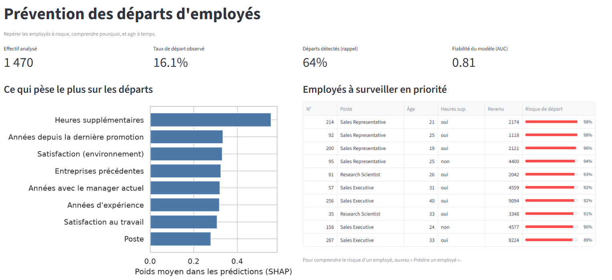
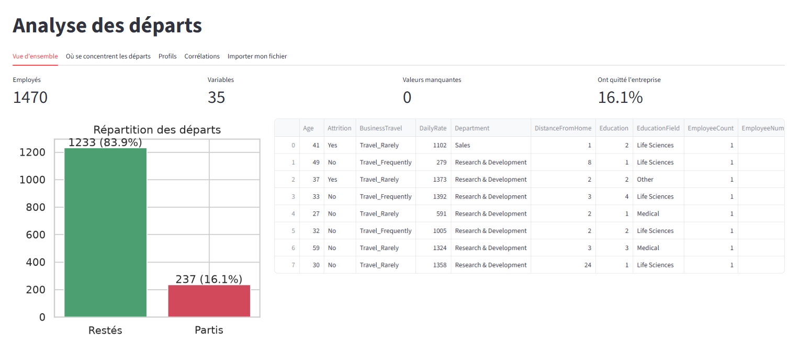
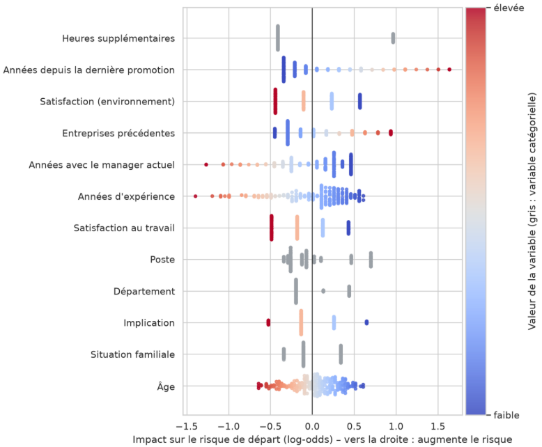
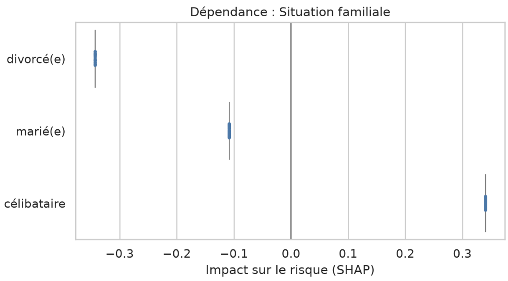

# 👥 Prévention des départs d'employés – Classification explicable (IBM HR Analytics)

| | Lien |
|---|---|
| 🌐 Application déployée (Streamlit Community Cloud) | [https://hr-attrition-fmwmjvdaq2i58tf2mummys.streamlit.app/](https://hr-attrition-fmwmjvdaq2i58tf2mummys.streamlit.app/) |
| ⚙️ API FastAPI, documentation Swagger (Render) | [https://hr-attrition-ygvc.onrender.com/docs](https://hr-attrition-ygvc.onrender.com/docs) |
| 💻 Dépôt GitHub | [github.com/ghassenHMD/HR-Attrition](https://github.com/ghassenHMD/HR-Attrition) |
| 📄 One-pager (PDF) | [docs/one_pager.pdf](docs/one_pager.pdf) |
| 📓 Notebook | [ibm-hr-attrition.ipynb](ibm-hr-attrition.ipynb) |


## En bref

| Régression logistique | |
|---|---|
| **AUC-ROC**  | **0,812** |
| **PR-AUC** | **0,588** |
| **Rappel** au seuil 0,58 | **64 %** : 30 des 47 départs détectés |
| **Précision** au seuil 0,58 | **48 %** : 30 alertes justifiées sur 63 (3 fois le taux de base de 16 %) |
| **Facteur n°1** | **Heures supplémentaires** : 30,5 % de départs contre 10,4 % sans |
| **Classement** | 87 % des 15 employés les mieux classés à risque sont réellement partis |

---

## 1. Problème métier

Chaque départ d'employé coûte cher : recrutement, formation, perte d'expertise. L'objectif est de **repérer les employés à risque**, de **comprendre pourquoi** (explications globales et individuelles) et d'orienter des **actions de rétention** avant la démission.

Le score est une **aide à l'entretien individuel**, jamais un outil de sanction ni de décision RH automatique.

## 2. Données

| | |
|---|---|
| Source | *IBM HR Analytics Employee Attrition & Performance* (Kaggle, `pavansubhasht/ibm-hr-analytics-attrition-dataset`) |
| Téléchargement | Automatique avec `kagglehub`, avec copie locale (`data/`) en secours |
| Taille | 1 470 employés · 35 variables (26 numériques, 9 catégorielles) · **0 valeur manquante** |
| Cible | `Attrition` : **237 départs (16,1 %)**, soit 5,2 employés restés pour 1 parti (classes déséquilibrées) |
| Variables retirées | `EmployeeCount`, `StandardHours`, `Over18` (constantes) et `EmployeeNumber` (identifiant) |
| Après préparation | 30 variables, **51 après encodage one-hot** |
| Découpage | Stratifié 80 / 20 : **1 176 employés d'entraînement, 294 de test (47 départs)** |

**Où se concentrent les départs ?**

| Variable | Groupe le plus touché | Taux de départ | Référence |
|---|---|---|---|
| Heures supplémentaires | Oui | 30,5 % | 10,4 % sans |
| Poste | Représentant commercial | 39,8 % | 2,5 % pour Research Director |
| Situation familiale | Célibataire | 25,5 % | 10,1 % pour divorcé |
| Déplacements professionnels | Fréquents | 24,9 % | 8,0 % sans déplacement |
| Âge | 30 ans et moins | 25,9 % | 8,9 % pour 36-43 ans |
| Stock-options | Niveau 0 | 24,4 % | 7,6 % au niveau 2 |
| Satisfaction au travail | Niveau 1 (faible) | 22,8 % | 11,3 % au niveau 4 |

Le revenu mensuel médian des partants est de 3 202, contre 5 204 pour les employés restés.

## 3. Préparation, modèles et résultats

**Préparation** : imputation (médiane / valeur la plus fréquente), standardisation des variables numériques, encodage one-hot des catégorielles, découpage stratifié paramétrable. Variables sensibles excluables via le paramètre `EXCLUDE`.

**Modélisation** : 5 modèles, pondération des classes (sauf KNN, qui ne la supporte pas ; `scale_pos_weight` pour XGBoost), optimisation par `GridSearchCV` (3 plis stratifiés, métrique AUC-ROC).

| Modèle | Meilleurs hyperparamètres | AUC CV | AUC test | PR-AUC | Rappel | Précision | F1 | Écart train-test |
|---|---|---|---|---|---|---|---|---|
| **Régression logistique** | C = 0,1 | **0,828** | **0,812** | **0,588** | 0,681 | 0,381 | **0,489** | **0,06** |
| Random Forest | max_depth = 20, n_estimators = 800 | 0,799 | 0,788 | 0,451 | 0,362 | 0,500 | 0,420 | 0,21 |
| XGBoost | learning_rate = 0,1, max_depth = 3, n_estimators = 200 | 0,795 | 0,758 | 0,454 | 0,383 | 0,391 | 0,387 | 0,24 |
| Arbre de décision | max_depth = 8, min_samples_leaf = 30 | 0,713 | 0,709 | 0,350 | 0,723 | 0,324 | 0,447 | 0,15 |
| KNN | n_neighbors = 31 | 0,762 | 0,700 | 0,355 | 0,043 | 1,000 | 0,082 | 0,14 |

*Métriques sur le jeu de test au seuil 0,5.*

**Meilleur modèle : la régression logistique.** Meilleure AUC et PR-AUC, et surapprentissage le plus faible : Random Forest et XGBoost atteignent une AUC d'entraînement de 1,00 contre 0,87 pour la régression logistique.

### Seuil de décision

Le seuil retenu est **0,58** (maximise le F1 : 0,545). Matrice de confusion sur les 294 employés de test :

| | Prédit : reste | Prédit : part |
|---|---|---|
| **Réel : reste** | 214 (VN) | 33 (FP) |
| **Réel : part** | 17 (FN) | 30 (VP) |

| Seuil | Employés signalés | Précision | Rappel |
|---|---|---|---|
| 0,30 | 146 | 27 % | 85 % |
| 0,50 | 84 | 38 % | 68 % |
| **0,58** | **63** | **48 %** | **64 %** |
| 0,70 | 39 | 56 % | 47 % |

Un seuil bas détecte plus de départs mais génère plus de fausses alertes ; le curseur de l'application permet à un RH d'arbitrer selon sa capacité de suivi.

## 4. Explainable AI

### Explications globales

- **Importance propre au modèle** : coefficients de la régression logistique (heures supplémentaires = oui : +0,69 ; technicien de laboratoire : +0,68 ; déplacements fréquents : +0,58 ; représentant commercial : +0,44), importance par impureté pour les modèles d'arbres.
- **Importance par permutation, comparable entre les 5 modèles** : les heures supplémentaires sont n°1 partout (baisse d'AUC : 0,105 régression logistique, 0,101 Random Forest, 0,097 XGBoost, 0,164 arbre, 0,037 KNN).
- **SHAP beeswarm et dépendance** : heures supplémentaires (9,1 % de l'influence), années depuis la dernière promotion, satisfaction (environnement et travail), nombre d'entreprises précédentes, années avec le manager actuel, années d'expérience, poste, département.

| Aggravent le risque | Protègent |
|---|---|
| Heures supplémentaires, années depuis la dernière promotion, entreprises précédentes, déplacements fréquents, distance domicile-travail, postes de technicien de laboratoire et de commercial, département Ventes | Satisfaction (environnement et travail), implication, années d'expérience, années avec le manager actuel, déplacements nuls |

### Explications locales

Pour chaque employé (saisi ou choisi dans le jeu de test) : probabilité, décision au seuil choisi, **SHAP waterfall**, **LIME**, comparaison des deux, phrase de synthèse et actions suggérées.


Les contributions sont **regroupées par variable d'origine** (`OverTime_Yes` + `OverTime_No` deviennent « Heures supplémentaires »), ce qui rend le waterfall lisible et exactement additif.

### Analyse critique

| Question | Réponse |
|---|---|
| **SHAP et LIME sont-ils cohérents ?** | Sur les 15 employés les plus à risque, ils s'accordent sur le **sens de l'effet dans 98 % des cas** (100 % sur 30 employés) mais ne partagent que 55 à 60 % de leur top 5 (LIME est une approximation locale par échantillonnage). Tous deux placent les heures supplémentaires et les déplacements en tête, ce qui correspond à l'intuition métier et aux taux observés. |
| **Variables sensibles et équité ?** | Âge, genre et situation familiale portent **9,7 % de l'influence SHAP** (situation familiale 3,9 %, rang 11 ; âge 3,7 %, rang 12 ; genre 2,2 %, rang 22). L'effet existe pourtant : célibataire +0,34 contre divorcé −0,34 ; moins de 30 ans +0,36 contre plus de 42 ans −0,34 (log-odds). Sans les 3 variables, l'AUC passe de 0,812 à 0,796 (−0,016) ; sans l'âge seul, elle monte à 0,820. On peut donc les exclure par précaution, avec une perte négligeable. Risque de discrimination indirecte envers les jeunes et les célibataires. |
| **Performance ou interprétabilité ?** | La régression logistique dépasse XGBoost de 0,054 d'AUC et de 0,134 de PR-AUC : **aucun compromis n'est nécessaire**. Recommandation : régression logistique (lisible, auditable), complétée par SHAP pour expliquer chaque cas. |
| **Actions concrètes ?** | Encadrer les heures supplémentaires ; cibler les commerciaux et techniciens de laboratoire ; entretien avec les employés insatisfaits ; plan d'évolution après une longue absence de promotion ; limiter les déplacements fréquents ; étudier l'intéressement. Détail dans le [one-pager](docs/one_pager.pdf). |

## 5. Application Streamlit

L'application est conçue pour un usage métier  et appelle l'API pour toutes les explications.

| Page | Contenu |
|---|---|
| **Tableau de bord** | Indicateurs clés, facteurs principaux, 10 employés à surveiller en priorité |
| **Analyse des départs** | Aperçu, statistiques, valeurs manquantes, proportion des classes, taux de départ par variable, distributions, corrélations, import d'un fichier CSV avec choix de la cible |
| **Prédire un employé** | Saisie d'un employé fictif ou choix dans le jeu de test, probabilité, décision, SHAP waterfall, LIME, phrase de synthèse, actions recommandées |
| **Performance des modèles** | Tableau comparatif, ROC et précision-rappel superposées, matrice de confusion, **curseur de seuil en direct**, hyperparamètres retenus, entraînement à la demande avec réglages choisis |
| **Facteurs de risque** | Importance native, permutation comparée entre modèles, SHAP beeswarm, dépendance par variable |
| **Équité et fiabilité** | Poids des variables sensibles, accord SHAP/LIME, compromis performance / interprétabilité |

## 6. API FastAPI

Documentation interactive : `/docs` (Swagger) et `/redoc`.

| Méthode | Route | Rôle |
|---|---|---|
| GET | `/` | État de l'API |
| GET | `/model/info` | Modèle déployé, métriques, seuil, variables sensibles |
| GET | `/features` | Variables attendues (libellés, types, bornes, modalités, valeur par défaut) |
| GET | `/samples/ranking` | Employés du jeu de test classés par risque décroissant |
| GET | `/samples/{idx}` | Un employé du jeu de test et la réalité observée |
| POST | `/predict` | Probabilité de départ et décision au seuil choisi |
| POST | `/explain/shap` | Contributions SHAP (waterfall) et phrase de synthèse |
| POST | `/explain/lime` | Contributions LIME |
| POST | `/explain/compare` | SHAP et LIME côte à côte, avec mesure d'accord |
| GET | `/explain/global` | Importance native, permutation (tous modèles), SHAP moyen |
| GET | `/explain/shap-values` | Valeurs SHAP du jeu de test (beeswarm, dépendance) |
| GET | `/explain/agreement` | Accord SHAP / LIME sur les n employés les plus à risque |
| GET | `/models/evaluation` | Probabilités de tous les modèles, tableau comparatif, hyperparamètres |
| POST | `/models/train` | Entraîne un modèle avec les hyperparamètres choisis |


## 7. Architecture

```
Notebook ──export──► artifacts/bundle.joblib ──► API FastAPI (Render) ◄──HTTP── Application Streamlit
(EDA, préparation,    (modèle, prétraitement,     /predict  /explain/*             (Streamlit Community Cloud)
 modèles, évaluation)  tables d'évaluation)       /models/*  /samples/*
```

## 9. Captures d'écran

| Tableau de bord | Analyse des départs |
|---|---|
|  |  |

| Performance et curseur de seuil | Explication d'un employé (SHAP waterfall) |
|---|---|
|  |  |

| SHAP beeswarm | Équité et fiabilité |
|---|---|
|  |  |


## 10. Installation et lancement en local

Python **3.12 ou supérieur** requis.

```bash
git clone https://github.com/ghassenHMD/HR-Attrition.git
cd HR-Attrition

# 1) API (http://127.0.0.1:8000/docs)
pip install -r api/requirements.txt
uvicorn api.main:app --reload

# 2) Application, dans un autre terminal
pip install -r requirements.txt
streamlit run app/streamlit_app.py

# 3) Tests de l'API
pip install pytest httpx
pytest
```

Pour pointer l'application vers une API distante : variable d'environnement `API_URL`, ou secret `API_URL` sur Streamlit Community Cloud.

**Régénérer les artefacts** : exécuter le notebook en entier ; la cellule 9 écrit `artifacts/bundle.joblib` et `data/`. Utiliser les mêmes versions de bibliothèques que `api/requirements.txt`.

## 11. Déploiement

| Composant | Plateforme | Configuration |
|---|---|---|
| API | Render (Web Service) | Build : `pip install -r api/requirements.txt` · Start : `uvicorn api.main:app --host 0.0.0.0 --port $PORT` · variable `PYTHON_VERSION` ≥ 3.12 |
| API (alternative) | Hugging Face Spaces (Docker) | `api/Dockerfile`, port 7860 |
| Application | Streamlit Community Cloud | Fichier principal `app/streamlit_app.py` · secret `API_URL = "https://xxx.onrender.com"` |

## 12. Structure du dépôt

```
├── ibm-hr-attrition.ipynb          # EDA, préparation, modèles, évaluation, export, analyse d'équité
├── WA_Fn-UseC_-HR-Employee-Attrition.csv   # copie locale (secours du notebook si Kaggle est indisponible)
├── data/                           # copie locale utilisée par l'application
├── artifacts/bundle.joblib         # modèle + prétraitement + tables (généré par le notebook)
├── api/
│   ├── main.py                     # service FastAPI
│   ├── requirements.txt
│   └── Dockerfile
├── app/streamlit_app.py            # application Streamlit
├── tests/test_api.py               # tests de l'API (pytest)
├── docs/                           # one_pager.pdf et captures d'écran
├── requirements.txt                # dépendances de l'application
└── README.md
```

## 13. Technologies

Python 3.12+ · pandas · NumPy · scikit-learn · XGBoost · SHAP · LIME · FastAPI · Uvicorn · Pydantic · Streamlit · Matplotlib · Seaborn · kagglehub · joblib · pytest.

## 14. Limites

- **Peu de données en test** : 47 départs sur 294 employés. Les résultats varient selon le découpage.
- **Seuil choisi sur le jeu de test** : légère surestimation possible de la précision et du rappel.
- **Jeu de données fictif** (IBM) : à revalider sur les données réelles de l'entreprise avant tout usage.
- **Explications ≠ causes** : SHAP et LIME décrivent le modèle, pas des relations causales.
- **Probabilités non calibrées** : la pondération des classes les déforme ; elles servent à classer, pas à chiffrer un risque exact.
- **LIME** : approximation locale par échantillonnage, moins stable que SHAP (55 à 60 % de variables communes dans le top 5).
- **API sans authentification** et hébergement gratuit mis en veille : à renforcer pour un usage réel.
- **Éthique** : le score ne doit jamais fonder une promotion, une augmentation ou un licenciement ; un audit d'équité régulier est nécessaire.

---
