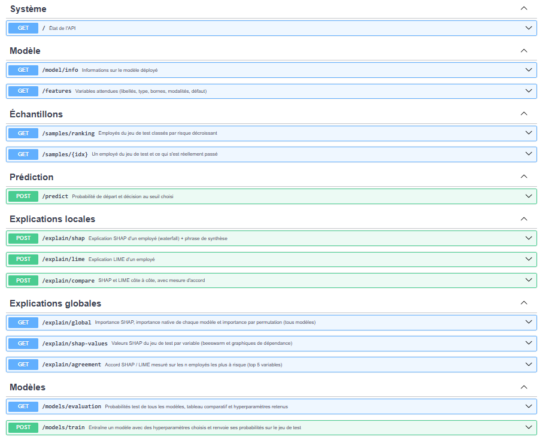
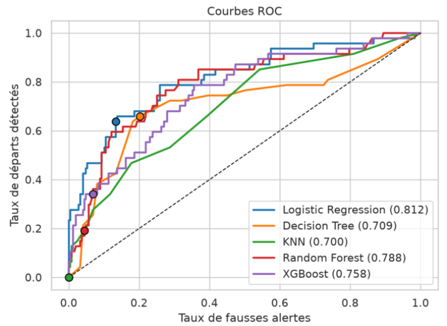
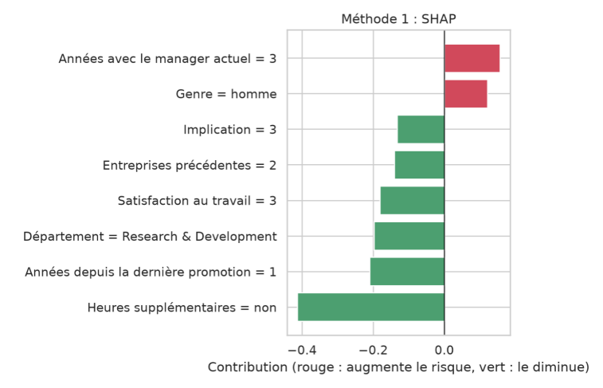

# Attrition des employés – Classification explicable (IBM HR)

Projet Data Mining ENSI 2026-2027 · Cas n°8 du catalogue · [Ton nom]

## Liens
- Application : https://....streamlit.app
- API (Swagger) : https://xxx.onrender.com/docs
- One-pager : docs/one_pager.pdf

## Architecture
Notebook → artifacts/bundle.joblib → API FastAPI → App Streamlit
(schéma ou texte)

## Fonctionnalités
Modules 1 à 6 (liste courte)

## Endpoints de l'API
| Méthode | Route | Rôle |
|---|---|---|
| GET | /model/info | Modèle déployé et métriques |
| GET | /features | Variables attendues |
| POST | /predict | Probabilité et décision |
| POST | /explain/shap | Contributions SHAP + phrase de synthèse |
| POST | /explain/lime | Contributions LIME |
| POST | /explain/compare | SHAP vs LIME |
| GET | /explain/global | Importance globale |

## Captures d'écran

## Lancer en local
pip install -r api/requirements.txt && uvicorn api.main:app --reload
pip install -r requirements.txt && streamlit run app/streamlit_app.py

## Limites
(2-3 lignes : pas d'authentification, API en veille, etc.)